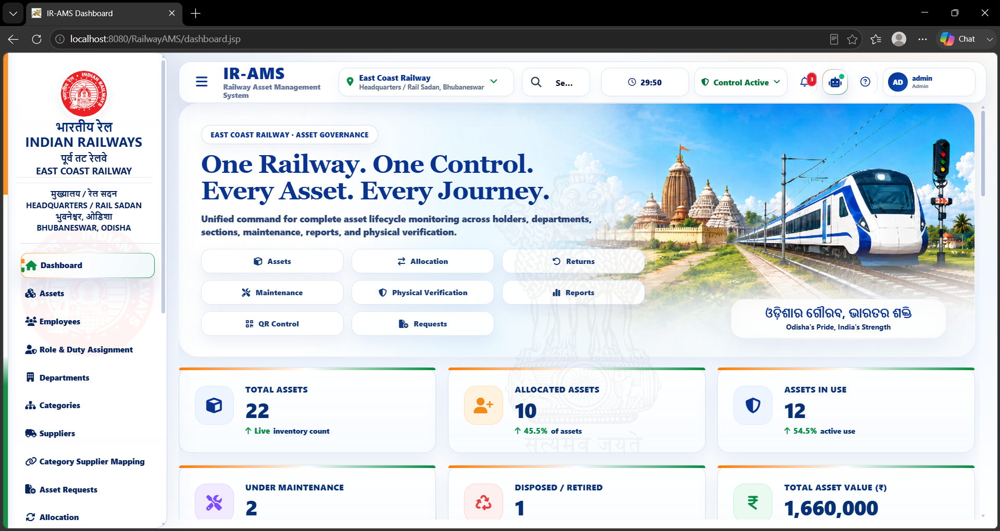
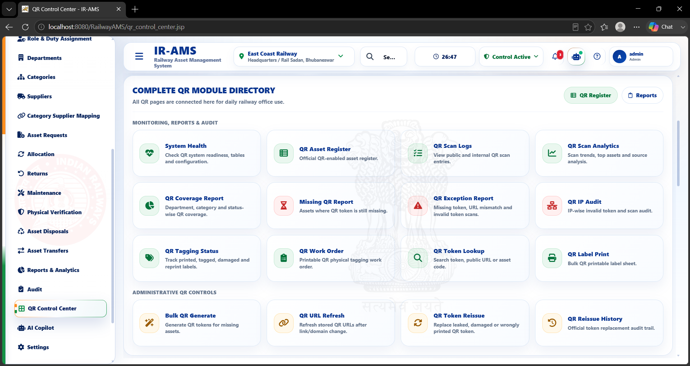
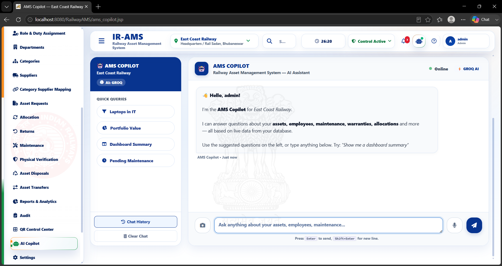
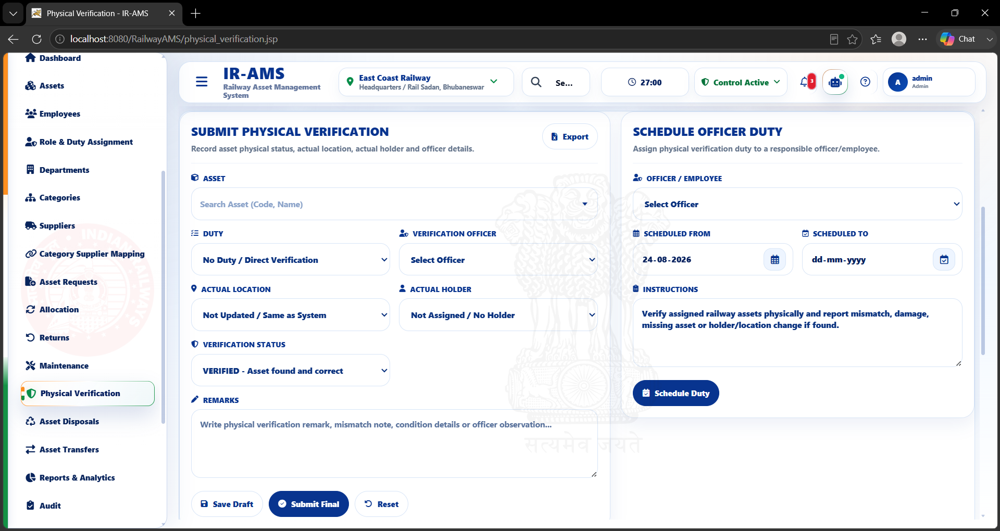
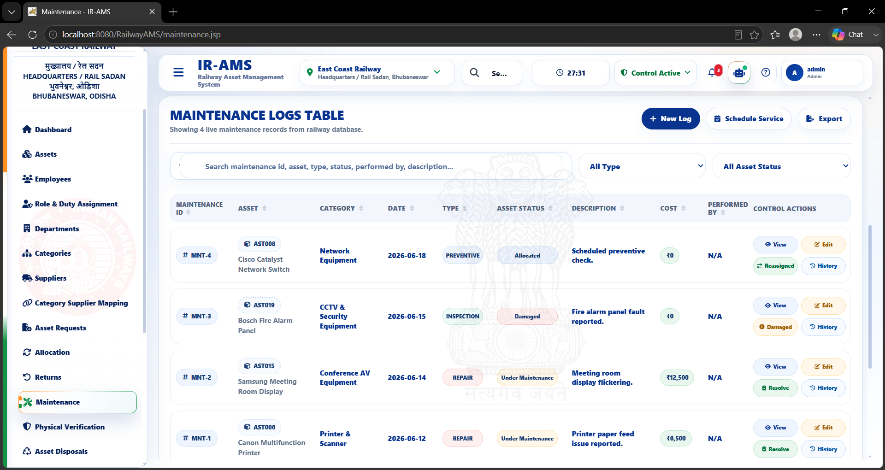
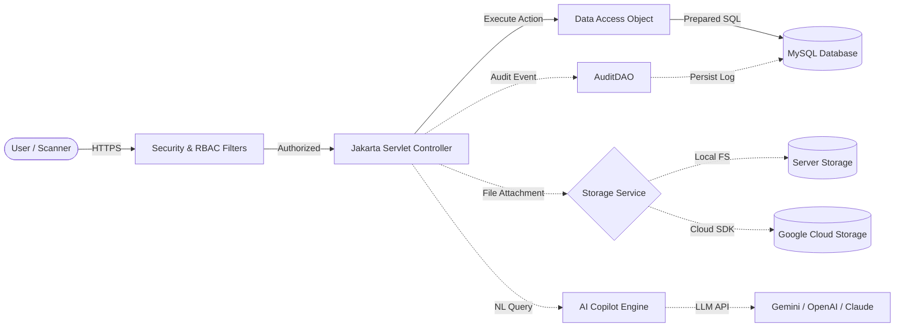
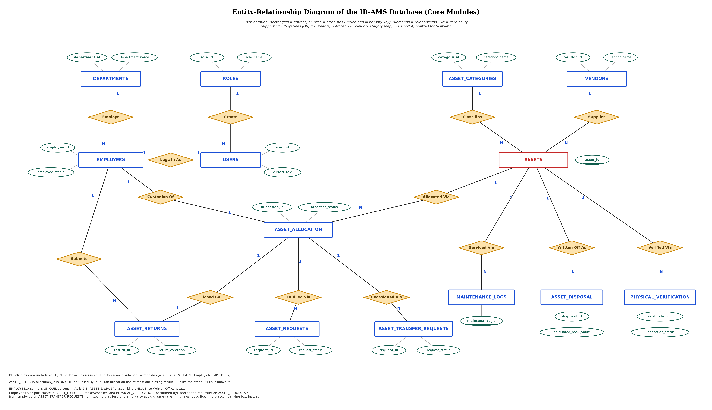

<div align="center">

# 🚆 Railway Asset Management System (AMS)
### Enterprise Asset Governance, Physical Verification, Dynamic QR Tagging & AI-Powered Operations

[](https://github.com/subhamsdhal/AMS-ASSET-MANAGEMENT-SYSTEM/actions/workflows/ci.yml)
[](https://openjdk.org/)
[](https://jakarta.ee/)
[](https://tomcat.apache.org/)
[](https://www.mysql.com/)
[](https://github.com/subhamsdhal/AMS-ASSET-MANAGEMENT-SYSTEM)
[](https://www.docker.com/)
[](LICENSE)

<p align="center">
  A production-grade, full-lifecycle digital asset management and physical verification platform engineered for public sector railway infrastructure, divisional headquarters, and enterprise operations.
</p>

[Key Features](#-key-features) • [Architecture](#-system-architecture) • [Module Directory](#-module-directory) • [Visual Showcase](#-visual-showcase) • [Tech Stack](#-technology-stack) • [Quick Start](#-quick-start--installation) • [Docker Deployment](#-docker-deployment) • [Documentation](#-documentation)

---

</div>

## 📌 Executive Summary

The **Railway Asset Management System (AMS)** is a unified, high-reliability enterprise application developed to govern the complete lifecycle of railway physical and technical assets — spanning capital procurement, employee allocation, dynamic QR serialization, scheduled physical verification, maintenance logging, warranty lifecycle alerts, and compliant asset disposal/retirement.

Designed specifically for organizational scale with zero heavy framework overhead, the system leverages a pure **Jakarta EE 10 + Raw JDBC (DAO pattern)** foundation for ultra-fast startup times, deterministic memory footprints, and rigorous non-repudiation auditing.

### 🌟 Core Highlights
- **28 Modular Subsystems:** Complete operational coverage from procurement to scrap.
- **42 Relational Tables:** Schema with referential integrity, constraints, and relational history.
- **203 Automated Unit & Security Tests:** 100% passing test suite across authentication, role duty authorization, and tool execution.
- **Dynamic QR Code Ecosystem:** Cryptographic QR token generation, bulk sticker printing, live scanner interface, and public asset inspection views.
- **Built-in Enterprise AI Copilot:** Multi-provider LLM support (Google Gemini, OpenAI, Anthropic Claude, Groq) with secure parameterized tool-calling and role-scoped query execution.
- **Tamper-Evident Audit Trail:** Centralized audit logging bound to client IP address and User-Agent headers.

---

## 📸 Visual Showcase

<div align="center">

### Executive Role-Based Analytics Dashboard
*Real-time visibility into asset distribution, department custody, verification coverage, and active maintenance.*



---

### QR Code Control Center & Bulk Tagging
*Manage base URLs, generate bulk cryptographic QR labels, track scanner telemetry, and configure secure Cloudflare/Ngrok tunnels for mobile field audit teams.*



---

### Intelligent AI Copilot Assistant
*Natural language asset querying, trend analysis, anomaly detection, and maintenance summaries with real-time database grounding and strict permission barriers.*



---

### Physical Verification & Field Audit Workflow
*Scheduled verification duties, barcode scanning, location mismatch flagging, and supervisor reconciliation.*



---

### Preventive Maintenance & Service Logs
*Service ticket tracking, vendor escalation, cost anomaly detection, and resolution verification.*



</div>

---

## 🏛️ System Architecture

Railway AMS follows a clean, decoupled **3-Tier Enterprise MVC Architecture**:

```
┌────────────────────────────────────────────────────────────────────────┐
│                        PRESENTATION TIER (JSP)                         │
│  Server-Rendered JSP 3.1 • Responsive CSS3 • Vanilla JS • Chart.js    │
│  HTML5 QR Scanner • Role-Based Navigation • XSS-Encoded Viewports      │
└────────────────────────────────────┬───────────────────────────────────┘
                                     │ HTTP / Session
┌────────────────────────────────────▼───────────────────────────────────┐
│                   SECURITY & CONTROLLER TIER (SERVLETS)                │
│  ┌──────────────────────────────────────────────────────────────────┐  │
│  │ Dual-Layer Filter Pipeline:                                      │  │
│  │ 1. SecurityHeadersFilter (CSP, X-Frame, IP Context Binding)      │  │
│  │ 2. RoleAuthorizationFilter (Deterministic In-Memory RBAC)        │  │
│  └──────────────────────────────────────────────────────────────────┘  │
│  190+ Servlets (Action Controllers) • Token Authentication              │
│  Background Schedulers (WarrantyAlertScheduler, BackupScheduler)       │
│  AI Engine (CopilotEngine, ToolCatalog, Parameterized CommandExecutor) │
└────────────────────────────────────┬───────────────────────────────────┘
                                     │ JDBC 9.3.0
┌────────────────────────────────────▼───────────────────────────────────┐
│                      DATA ACCESS & PERSISTENCE TIER                    │
│  Data Access Objects (DAO Pattern) • 100% Parameterized PreparedStmts │
│  CryptoUtil (AES-256 for API Keys) • Document Storage (Local / GCS)   │
│  Centralized AuditDAO (Thread-Safe RequestContext Capture)             │
└────────────────────────────────────┬───────────────────────────────────┘
                                     │ TCP / Socket Factory
┌────────────────────────────────────▼───────────────────────────────────┐
│                         DATA STORAGE TIER                              │
│  MySQL 8.0+ / Google Cloud SQL • 42 Relational Tables • Views & Triggers│
└────────────────────────────────────────────────────────────────────────┘
```

### Architectural Data Flow:


### Complete Entity-Relationship (ER) Model
The relational schema models 42 tables capturing assets, classifications, personnel, custody allocations, verifications, maintenance, QR tokens, and system settings.

*Vector diagram available in [`docs/images/fig2_er_diagram_landscape.svg`](docs/images/fig2_er_diagram_landscape.svg).*

<div align="center">
  
</div>

---

## 🧩 Module Directory

The system is organized into 28 functional modules, each thoroughly audited and documented:

| # | Module | Core Responsibilities | Target Roles |
|---|---|---|---|
| **01** | **Authentication & Session** | jBCrypt password hashing, session fixation defense, account lockout, forced password change | All Users |
| **02** | **RBAC & Duty Delegation** | In-memory permission matrix, temporary duty assignments, administrative role management | Super Admin, Admin |
| **03** | **Executive Dashboard** | Role-scoped KPI cards, upcoming maintenance alerts, warranty expiries, budget utilization | Role Scoped |
| **04** | **Asset Registry** | Master CRUD, unique asset identification, cost basis, depreciation, serial tracking | Asset Manager, Admin |
| **05** | **Asset Categories** | Hierarchical classification, depreciation policy definitions | Asset Manager |
| **06** | **Vendors & Suppliers** | Supplier contracts, vendor evaluation, document attachment repository | Asset Manager, Admin |
| **07** | **Category-Vendor Mapping**| Approved supplier matrices per asset category | Asset Manager |
| **08** | **Personnel & Employees** | Employee directory, department affiliation, digital ID, profile management | Admin, Dept Head |
| **09** | **Departments** | Organizational units, divisional cost centers, department-level oversight | Admin |
| **10** | **Asset Allocation** | Custody assignment, transfer of custody, employee acknowledgments | Asset Manager, Admin |
| **11** | **Asset Returns** | Check-in workflows, condition assessment, reallocation staging | Asset Manager, Employee |
| **12** | **Employee Transfer** | Inter-departmental reassignments, automatic asset custody handoff / clearance | Admin, Dept Head |
| **13** | **Asset Requests** | Employee requisition workflow, approval chain, inventory reservation | Employee, Admin |
| **14** | **Maintenance Management** | Corrective & scheduled service logging, cost tracking, status progression | Asset Manager, Admin |
| **15** | **Maintenance Requests** | Issue ticketing by end-users, photo attachments, technician dispatch | Employee, Technician |
| **16** | **Physical Verification** | Scheduled audit rounds, barcode/QR discrepancy reconciliation, supervisor review | Auditor, Verifier |
| **17** | **Disposal & Retirement** | Scrap, auction, write-off approval workflow with audit justification | Super Admin, Admin |
| **18** | **Warranty Management** | Warranty renewal history, supplier SLA tracking, automatic expiry alerts | Asset Manager |
| **19** | **QR Control Center** | ZXing QR generation, token reissuing, remote scanner tunnels, public scan views | Admin, Field Teams |
| **20** | **Notification Service** | Dual in-app alerts and Jakarta Mail SMTP email dispatch engine | All Users |
| **21** | **Reports & POI Exports** | Apache POI multi-sheet Excel workbooks, PDF audit summaries, live data export | Auditor, Admin |
| **22** | **Audit Trail** | Immutable log of all system mutations stamped with IP, User-Agent, and actor | Auditor, Super Admin |
| **23** | **Profile Requests** | Employee self-service change requests with administrative review gate | Employee, Admin |
| **24** | **Global Search** | Instant cross-entity search spanning assets, serials, employees, and documents | All Users |
| **25** | **Settings & Database Ops**| Database backups, recovery tools, AES key management, system toggles | Super Admin |
| **26** | **AI Copilot** | Multi-model LLM engine, read/write intent classifier, parameterized tools, anomaly alerts | Role Scoped |
| **27** | **Document Vault** | Multi-entity file attachments, Google Cloud Storage integration, PDFBox indexing | Admin, Asset Manager |
| **28** | **Tunnel / Ops Control** | Cloudflare / Ngrok tunnel orchestration for mobile physical scanning over HTTPS | Admin |

*Complete technical documentation for all modules can be found in [`docs/audit/`](docs/audit/).*

---

## 🛠️ Technology Stack

| Layer | Technologies & Standards | Purpose |
|---|---|---|
| **Runtime & Core** | **Java 17 / 21 / 26**, **Jakarta EE 10** | Modern, long-term supported enterprise Java runtime |
| **Web Container** | **Apache Tomcat 10.1+** (or Cloud Run / Docker) | High-performance, lightweight servlet 6.0 container |
| **Persistence** | **Raw JDBC (MySQL Connector/J 9.3.0)** | Zero ORM overhead, full query transparency and performance |
| **Database** | **MySQL 8.0+** / **Google Cloud SQL** | ACID-compliant relational data store with foreign key integrity |
| **Security** | **jBCrypt 0.4**, **AES-256 (`CryptoUtil`)** | Salted password hashing, encrypted API credential vault |
| **QR & Barcodes** | **Google ZXing 3.5.3** | High-density QR code matrix rendering and token generation |
| **Document Processing**| **Apache POI 5.3.0**, **Apache PDFBox 3.0.1** | Native `.xlsx` report export and full-text PDF parsing |
| **Mailing Service** | **Jakarta Mail 2.0.1** | Asynchronous SMTP notifications (e.g. Gmail / enterprise SMTP) |
| **AI Integration** | **org.json**, **Gemini / OpenAI / Claude REST APIs** | Enterprise LLM tool execution and natural language analytics |
| **Cloud Storage** | **Google Cloud Storage SDK 2.36.0** | Object storage abstraction for scalable document management |
| **Testing** | **JUnit 5.10.2**, **Mockito 5.11.0** | Automated regression, role security, and NLU intent testing |
| **Build & Tooling** | **Apache Maven 3.9+**, **Maven Wrapper (`mvnw`)** | Reproducible, platform-independent build pipeline |

---

## 🚀 Quick Start & Installation

### Prerequisites
- **JDK 17 or higher** (`java -version`)
- **MySQL 8.0+** running locally or on a server
- **Git**

### 1. Clone Repository
```bash
git clone https://github.com/subhamsdhal/AMS-ASSET-MANAGEMENT-SYSTEM.git
cd AMS-ASSET-MANAGEMENT-SYSTEM
```

### 2. Database Initialization
Create the database and load the schema and reference seed data:
```bash
# Log in to MySQL and create database
mysql -u root -p -e "CREATE DATABASE asset_management_system CHARACTER SET utf8mb4 COLLATE utf8mb4_unicode_ci;"

# Import schema and initial seed data
mysql -u root -p asset_management_system < database/schema.sql
mysql -u root -p asset_management_system < database/seed_data.sql
```

### 3. Configure Credentials
Configure your database connection via environment variables or the configuration file:

**Option A: Environment Variables (Recommended)**
```bash
export AMS_DB_URL="jdbc:mysql://localhost:3306/asset_management_system?useSSL=false&allowPublicKeyRetrieval=true&serverTimezone=Asia/Kolkata"
export AMS_DB_USER="root"
export AMS_DB_PASSWORD="your_password"
export AMS_CRYPTO_KEY="RailwayAMSSecureKeyForAESEncrypt"
```

**Option B: Property File**
```bash
# Copy template
cp src/main/resources/db.properties.example src/main/resources/db.properties

# Edit values to match your local MySQL configuration
```

### 4. Build and Test
Use the included Maven Wrapper (no separate Maven install required):

```bash
# On Linux / macOS
./mvnw clean test

# On Windows
.\mvnw.cmd clean test
```
*All 203 automated tests will execute and validate DAOs, controllers, security filters, and AI classifiers.*

### 5. Package Application
```bash
./mvnw clean package
```
The compiled enterprise archive is generated at:
```
target/RailwayAMS.war
```

### 6. Run on Apache Tomcat
Copy `target/RailwayAMS.war` to your Tomcat 10.1 `webapps/` directory:
```bash
cp target/RailwayAMS.war /path/to/tomcat/webapps/ROOT.war
/path/to/tomcat/bin/startup.sh
```
Access the application at:
```
http://localhost:8080/
```

---

## 🐳 Docker Deployment

The repository includes a production-ready, multi-stage [`Dockerfile`](Dockerfile) that builds the project from source and deploys it onto an official hardened Tomcat 10.1 image:

### Build Container
```bash
docker build -t railway-ams .
```

### Run Container
```bash
docker run -d \
  -p 8080:8080 \
  -e AMS_DB_URL="jdbc:mysql://host.docker.internal:3306/asset_management_system?useSSL=false&allowPublicKeyRetrieval=true&serverTimezone=Asia/Kolkata" \
  -e AMS_DB_USER="root" \
  -e AMS_DB_PASSWORD="your_password" \
  -e AMS_CRYPTO_KEY="RailwayAMSSecureKeyForAESEncrypt" \
  --name railway-ams-app \
  railway-ams
```

---

## 🔒 Security & Hardening Features

- **Salted Password Hashing:** Uses `BCrypt.hashpw()` with per-user cryptographic salts.
- **Strict Parameterization:** 100% of SQL statements utilize `java.sql.PreparedStatement` to eliminate SQL injection attack vectors.
- **Cross-Site Scripting (XSS) Defenses:** Systematic HTML escaping across user-supplied fields using `HtmlEscapeUtil`.
- **Deterministic Filter Chain:** `SecurityHeadersFilter` applies essential security headers (`X-Content-Type-Options: nosniff`, `X-Frame-Options: SAMEORIGIN`, `Referrer-Policy: strict-origin-when-cross-origin`) and binds client IP to `RequestContext` before any controller logic executes.
- **Role-Based Access Control (RBAC):** `RoleAuthorizationFilter` enforces zero-trust URL endpoint permission checking based on session attributes.
- **Encrypted Credential Vault:** External LLM keys (Gemini, Claude, OpenAI) are encrypted via AES before being stored in the database.

---

## 📁 Repository Structure

```
AMS-ASSET-MANAGEMENT-SYSTEM/
├── .github/
│   ├── workflows/ci.yml           # Automated Maven CI build & test pipeline
│   ├── ISSUE_TEMPLATE/            # Standardized bug & feature templates
│   └── pull_request_template.md   # PR checklist and guidelines
├── .mvn/wrapper/                  # Official Maven Wrapper runtime
├── database/
│   ├── schema.sql                 # Complete database schema (42 tables)
│   ├── seed_data.sql              # Default roles, categories & system settings
│   ├── reset_database.sql         # Test environment reset script
│   └── migrations/                # Incremental database migration scripts
├── docs/
│   ├── audit/                     # 31 comprehensive module audit specifications
│   ├── images/                    # UI screenshots, architecture & ER diagrams
│   └── DEMO_CHECKLIST.md          # Verification and presentation checklist
├── scripts/
│   ├── verify_buttons.ps1         # Automated button UI test script
│   └── verify_permissions.ps1     # Automated API & permission smoke test
├── src/
│   ├── main/
│   │   ├── java/.../ams/          # 190+ Servlets, DAOs, AI Engine, Models, Utilities
│   │   ├── resources/             # Configuration templates & migration bundles
│   │   └── webapp/                # JSPs, CSS stylesheets, JavaScript, assets
│   └── test/java/.../ams/         # 28 test classes (203 JUnit 5 & Mockito tests)
├── .editorconfig                  # Code formatting standard across IDEs
├── .env.example                   # Environment configuration template
├── .gitattributes                 # Line ending and binary handling configuration
├── .gitignore                     # Production Git exclusion rules
├── CONTRIBUTING.md                # Development workflow and PR instructions
├── Dockerfile                     # Multi-stage production container build
├── LICENSE                        # MIT Open-Source License
├── mvnw / mvnw.cmd                # Maven Wrapper executables
├── pom.xml                        # Project Object Model & dependencies
├── README.md                      # Project documentation showcase
└── schema.sql                     # Primary SQL schema reference
```

---

## 🧪 Testing & Validation

The test suite thoroughly verifies core business domains, RBAC barriers, and AI tool safety:

```bash
./mvnw test
```

### Test Coverage Summary:
- **`AdminHandoffTest`**: Administrative role transfer and access reassignment.
- **`AssetDAOTest`**: Relational asset state persistence and query integrity.
- **`BackupSchedulerTest`**: Automatic backup schedules and rotation logic.
- **`CopilotCommandExecutorSecurityTest`**: Prevention of unauthorized mutations via AI tool calling.
- **`CopilotContextUnderstandingTest`**: Natural language entity extraction and query normalization.
- **`CopilotRegressionTest`**: Intent classification and tool catalog integrity.
- **`RoleAccessUtilTest`**: Default-deny endpoint protection across all user tiers.
- **`LoginServletIntegrationTest`**: Account lockouts, password verification, and session lifecycle.
- **`PasswordUtilTest`**: BCrypt hash generation, salting, and legacy crypto compatibility.

---

## 📄 License & Attribution

This project is licensed under the **MIT License** — see the [LICENSE](LICENSE) file for details.

Developed by **Subham Swastik Dhal** for the **Asset Management System (AMS)** project, engineered for **Indian Railways / East Coast Railway (ECoR)**.

